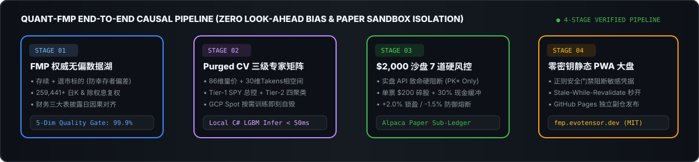

# 📈 Quant-FMP-UI · 美股全市场量化研究展示看板

**纯静态零构建 PWA 量化投研大盘 · 覆盖全美无偏数据湖、三级金字塔多空 Alpha 推演与 $2,000 零成本沙盘验证**

 

---

> [!CAUTION]
> **⚠️ 醒目金融风险与非投资建议免责声明 (NOT FINANCIAL OR INVESTMENT ADVICE)**
> 1. **纯学术与算法研究用途**：本仓库（`Quant-FMP-UI`）及线上看板（`fmp.evotensor.dev` / `quant.evotensor.dev`）展示的所有美股多空 Alpha 预测排名、宏观体制权益敞口建议、回测夏普/IC 指标以及 `$2,000 USD`（30W 日元）沙盘组合，**均由自动化机器学习模型基于历史数据生成，仅供量化工程与计算机科学学术研究，绝不构成任何证券买卖邀约、投资建议或收益承诺**。
> 2. **历史表现不代表未来收益**：金融市场充满非平稳博弈与黑天鹅风险，样本外历史回测与 Alpaca Paper 虚拟模拟盘表现无法代表真实市场流动性冲击下的实盘收益。当前实盘持仓严格为零（`Zero Live Positions`），任何据此进行实盘交易的风险完全由使用者自行承担。

---

## 1. 端到端因果量化流水线架构

  

---

## 2. 看板核心模块与特性矩阵

| 页面模块 | 路径文件 | 核心展示内容与技术特性 |
| :--- | :--- | :--- |
| **🏠 平台总览首页** | [`index.html`](index.html) | 全量日 K 底座（259,441+ 根）、公司行为（分红/拆股）、99.9 质量门禁评分、最新周频多空推演横幅与研发大事记时间轴 |
| **📋 事务历史与计划** | [`transactions.html`](transactions.html) | 基础数据入库、模型训练拟合与盘前预测推演的历史事务审计流水（`transaction_registry.json`）与调度计划 |
| **🗄️ 基础数据事务** | [`base-data-transactions.html`](base-data-transactions.html) | 覆盖存续与退市标的的多精度行情、财务三大表微观画像、美债宏观收益率与五维连续性审计报告 |
| **🧠 模型事务与预测** | [`model-transactions.html`](model-transactions.html) | Tier-1 SPY 宏观体制总控 + Tier-2 四大聚类专家（科技成长/高Beta算力/周期能源/防御价值）71 标的多空 Alpha 排行榜 |
| **🛡️ 交易与零成本沙盘** | [`trading-transactions.html`](trading-transactions.html) | Alpaca Paper `$2,000 USD`（30W 日元）专款子账本 30 日验证、单票 `$200` 碎股调仓、滑点核算与 7 道硬风控门禁状态 |

---

## 3. 零构建原生技术栈与资金安全隔离

1. **零构建轻量化（Zero-Build Vanilla Web）**：采用语义化 HTML5 + 原生 Vanilla CSS + ES Modules 构建，无需任何 Node.js / Webpack 打包环境，克隆后直接打开或通过静态服务器即可极速预览。
2. **工业级 PWA 离线优先**：内置 [`sw.js`](sw.js) 与 [`manifest.webmanifest`](manifest.webmanifest)，采用 `Stale-While-Revalidate` 策略实现首屏毫秒级秒开，支持桌面与移动端一键安装（A2HS）。
3. **展示层零密钥铁律**：所有页面通过异步读取 [`assets/data/`](assets/data/) 下的脱敏只读 JSON 切片渲染；同步发布脚本内置正则安全门禁，强制拦截任何 API Key 或未脱敏订单 UUID。

---

## 4. 开源许可证 (License)

本公开展示仓库（`QQDDTT/Quant-FMP-UI`）中的脱敏前端代码、样式表与 SVG 视觉资产采用 **[MIT License](LICENSE)** 开源授权。底层私有工程主仓库受专有许可保护。
